# 8-Bit Pipeline ADC

ESE 6680 Mixed Signal Circuit Design and Modeling · Dr. Tania Khanna · Spring 2025 · Kai Segimoto, Isaac Klein

> Markdown version of [`ESE 6680 Pipeline ADC.docx`](ESE%206680%20Pipeline%20ADC.docx) for reading on GitHub. The original Word file is in this repository.

## Topology Description

This report outlines the design of an 8 bit pipeline ADC architecture utilizing 1.5 bits per stage. Each stage calculates 1 bit of the digital output, with half a bit of redundancy for error correction and to account for inaccuracy in the design. The redundancy is resolved with a digital error correction schematic, and the output is time aligned through the use of serial in parallel out (SIPO) shift registers. The details of each stage and each sub schematic will be outlined in the following sections.

## 1.5 Bit single stage

A 1.5 bit analog to digital conversion is performed on each stage of the ADC, which generates codes 00, 01, and 10. The stage works by taking the input and converting it into the 1.5 bit value using a Flash ADC. Then, the digital value from the ADC is converted into an analog reference value using a sub-dac. This value is then subtracted from the input signal, which is sampled using a Sample and Hold Amplifier (SHA), and then multiplied to obtain the full scale range which is the residual voltage. The output of one stage serves as the input into the subsequent stage, which is used to find the next bit of the digital output. The schematic for the 1.5 bit stage is shown below.

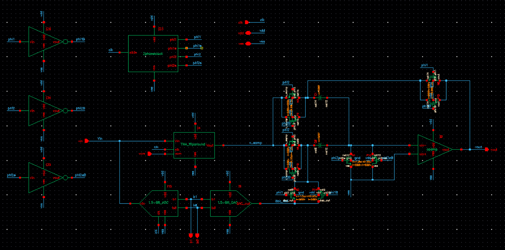

1.5 Bit Stage

Each section of the 1.5 bit stage will be described in the following sections.

### Non Overlapping Clock Generator

To be able to operate the pipeline ADC, many of the subcircuits such as the switch capacitor circuits are clocked, and require non-overlapping clock signals. To generate the non-overlapping signals and early signals, the following circuit is used.

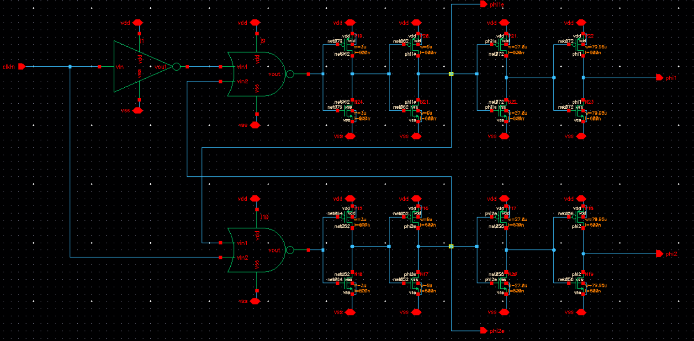

Non Overlapping Clock Schematic

A series of inverters using a fanout of 3 is used, which is the same as what was utilized in project 2. A fanout of 3 was used in order to ensure non-overlapping behavior for driving large loads.

### Flip-Around Sample and Hold Amplifier

In order to hold the input signal during the sampling clock phase, a Flip-Around Sample and Hold Amplifier was implemented, which is the same SHA design used in project 2. The design for the sample and hold is shown below.

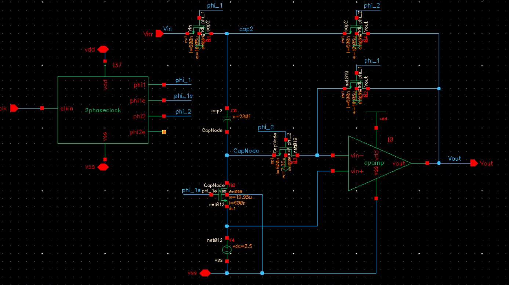

Flip-Around SHA Schematic

The SHA operates by sampling the input signal onto the capacitor during the first phase of the clock, phi1, then during phi2 the change on the capacitor is “flipped around” and held at the output.

### 1.5 Bit Sub ADC

To convert the analog input into the digital 1.5 bit output, a 1.5 bit flash ADC is used in each stage as the Sub ADC. The circuit is shown below.

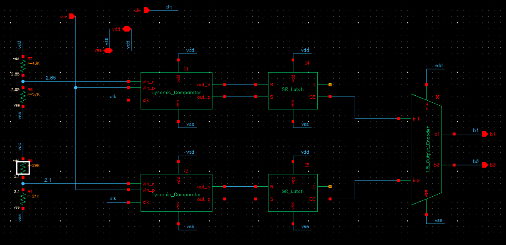

1.5 Bit flash ADC

The sub ADC operates by sampling the input signal and comparing it to reference voltages, and generating a thermometer code depending on if the voltage is below, between, or above the two reference voltages. In order to generate the correct residuals as shown below, we must generate two reference voltages.

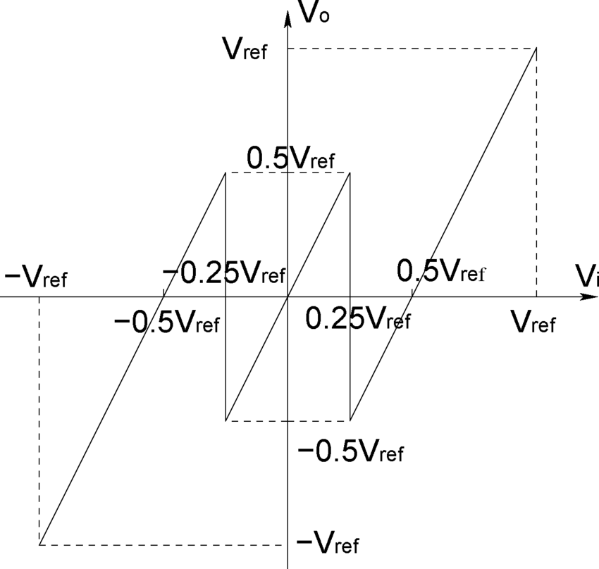

1.5 bit flash adc reference voltages

For our purposes with a FSR between 1 to 4, in order to divide the voltages into three ranges using the following calculation:

V<sub>ref1</sub> = V<sub>cm</sub> + FSR/8 = 2.5 + ⅜ = 2.875 V

V<sub>ref2</sub> = V<sub>cm</sub> - FSR/8 = 2.5 - ⅜ = 2.125 V

These voltages are used as a baseline, however they are later modified due to inaccuracies in the residual, and values of **V<sub>ref1</sub> = 2.85 V** and **V<sub>ref2</sub> = 2.1 V** are used as the reference voltages. The design reasoning and process for this change will be outlined in the Design Reasoning section. The reference voltages are generated using resistive dividers.

V<sub>ref1</sub> = 5 \* 57k/(57k + 43k) = 2.85 V

V<sub>ref2</sub> = 5 \* 21k/(21k + 29k) = 2.1 V

To compare the reference voltages to the input analog signal, dynamic latch comparators are used. The same schematic as the provided dynamic comparator in project 2 is implemented, shown below.

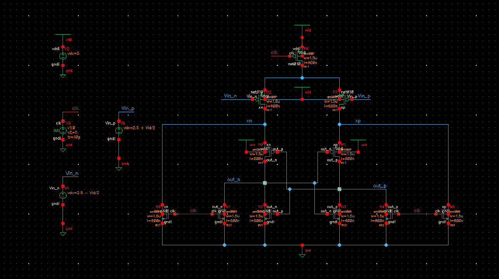

Dynamic Latch Comparator Schematic

Because the output signal of the Dynamic comparator is clocked, and the signal only outputs when the clock is low and the signal must be held constant, the output is latched using an SR latch.

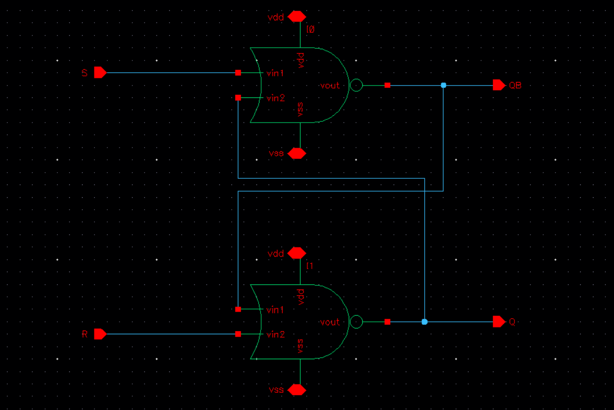

SR Latch Schematic

Finally, in order to create the necessary output codes, the thermometer code must be encoded into a bitwise scheme. This is done using a thermometer to binary encoder.

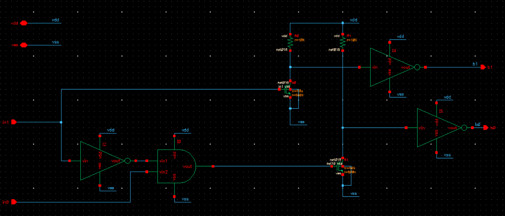

1.5 bit thermometer code to binary encoder

Depending on the input, thermometer code, only one or none of the nmos pull down transistors will have a high signal and output a 1, and when the gate of the nmos is low the pullup resistor pulls the signal high, which is inverted by the inverter to generate the correct code.

### 1.5 Bit Sub DAC

Next, a 1.5 Bit Sub DAC is designed to convert the digital code into analog reference values to use in the MDAC. The DAC operates using a resistive string that generates three reference voltages. How the voltages are selected are described in detail in the following MDAC section.

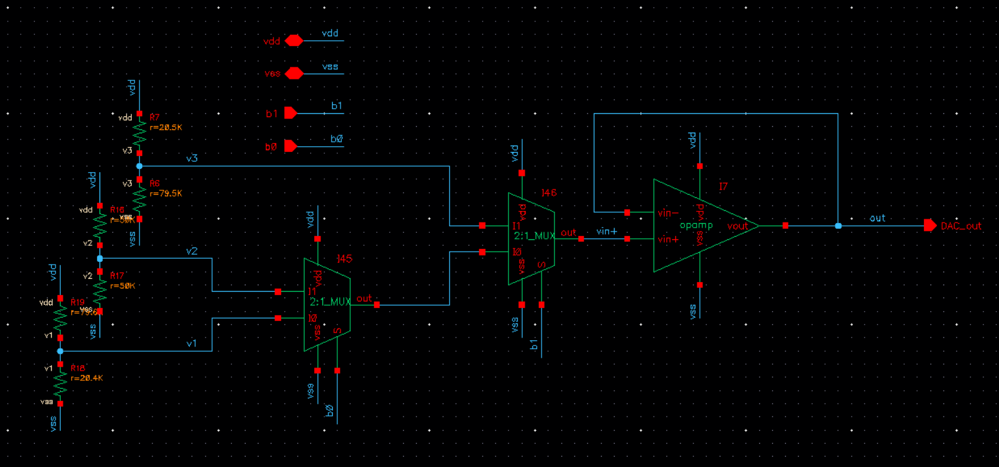

1.5 Bit DAC

The three voltages are determined by using 2 2:1 MUXs. The 2:1 MUX uses transmission gates, and because there is no current being drawn through the transmission gate, there is no voltage drop. It is important to use transmission gates because for high reference voltages, the NMOS cannot pass the high value well due to not being in the saturation region, so PMOS must also be used to pass the high values.

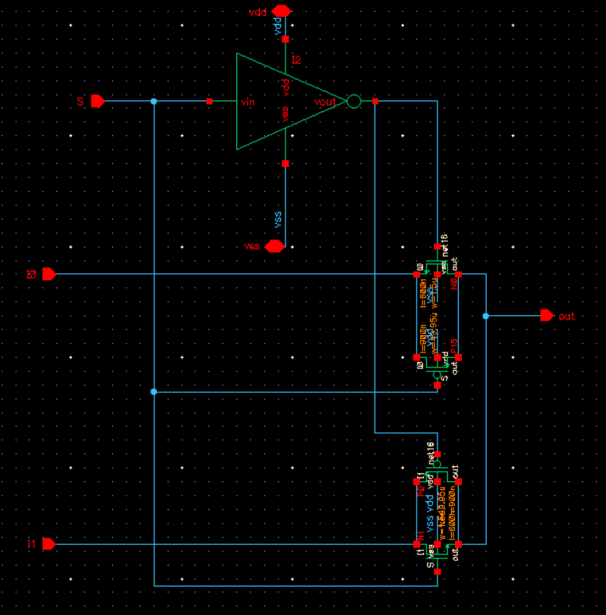

2:1 Mux with transmission gates

Finally, the output of the DAC is buffered using a unity gain buffer, so the loading effects of the Switch capacitor component of the MDAC does not cause changes in the reference voltages generated by the DAC.

### Multiplying DAC (MDAC) Switch Capacitor circuit

The Switch capacitor component of the MDAC implements the subtraction and gain components of the pipeline stage.

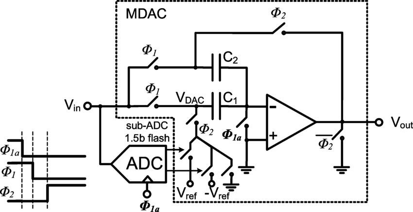

1.5 bit MDAC reference

The three reference voltages that need to be generated are the two ends of the FSR and the midpoint. For a FSR from Vref to -Vref, shown in the figure below, the three reference voltages needed are Vref, FSR/2 (0 or GND), and -Vref.

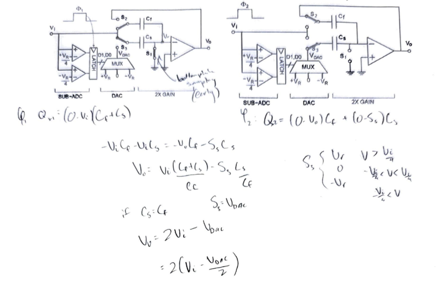

Switch Capacitor Hand Calculations

V<sub>out</sub> = 2(V<sub>in</sub> - V<sub>DAC</sub>/2)

However, for our application, we use a FSR from 1 to 4V, so the three reference voltages that are needed are 1V, 4V, and 2.5V. A gain or 2 is required to expand the residual into the full scale range, so the capacitors in the circuit are held constant.

These **reference voltages are tuned to 3.975V, 2.5V, 1.02V** in order to generate more precise residual voltages, which will again be explained in the design reasoning section.

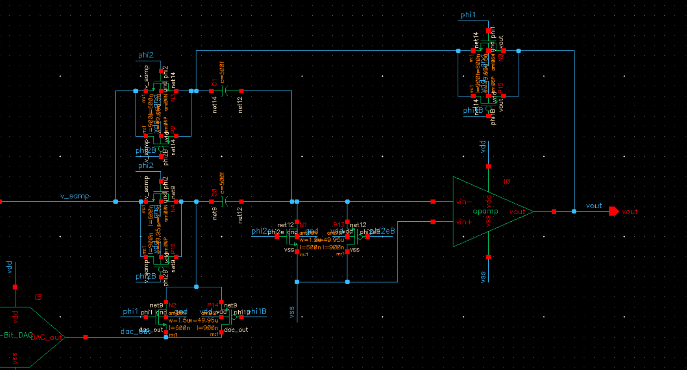

1.5 bit MDAC schematic

For the switch capacitor circuit of the MDAC, all switches are implemented using transmission gates in order to be able to pass high voltage values. The exact transistor sizing and capacitor sizing is simulated using parametric sweeps in order to obtain the most accurate residual voltage graph. Additionally, the switches must be clocked such that the capacitors are sampling while the sample and hold is “holding” the sampled value – this means that when our sample and hold is outputting the sampled value during phi2 of the clock, the switches taking in the sampled voltage must be on during phi2, and off during phi1 when it is not holding the correct voltage. This is why the implemented schematic has opposite phase values on the switches compared to the reference schematic.

## Time alignment and Digital Error Correction

In order to recombine the 1.5 bit outputs from each of the stages, the outputs need to be aligned in time and then combined to convert 8 1.5 bit outputs into one single 8 bit output.

### Time Alignment

Each successive 1.5 bit stage is one full clock cycle behind because the MDAC samples during phi2 and outputs during phi1, at which the sample and hold is sampling the output, the output of the first stage is 1 clock cycle earlier than the second stage, and so on. The outputs must all be aligned on the same clock cycle when they are combined in the error correction. There are 2 bits for each stage, so 2 8 bit time alignment circuits are created, which are essentially 8 8-bit shift registers, which store the data in a register for one clock cycle and then move it to the next and repeat this process for however many bits it can hold. The 8-bit shift register was implemented using eight D flip-flops in series as seen in the schematic below. The D flip-flops each consist of two D latches with opposite clocks, only allowing data to be transferred at the falling edge of the clock. This allows each bit to be stored at an output for one clock cycle and then be shifted to the next location. The first bit (MSB) is taken from the last output, which is delayed the longest while it waits for the last bit (LSB) to get shifted once before recombining. The time alignment circuits are shown below.

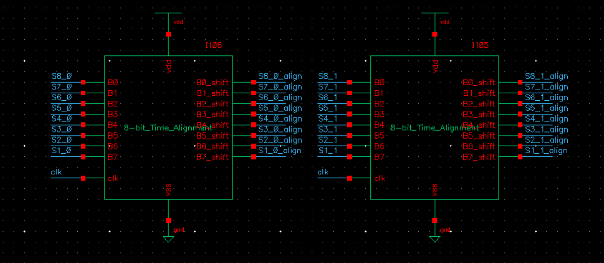

TIme Alignment High level

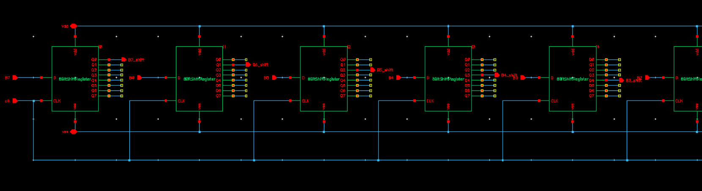

8-bit Time Alignment

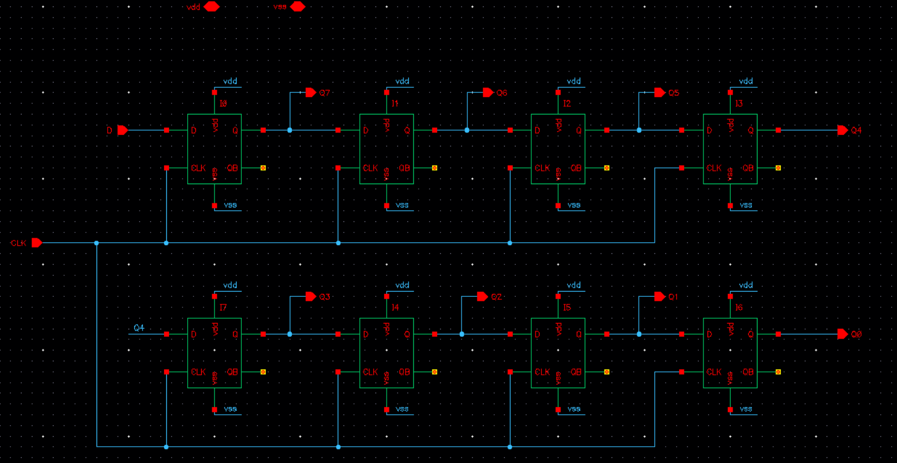

8 Bit Shift Register

### Digital Error Correction

Finally, with all the output bits aligned in time correctly, they must be recombined to find the final 8 bit code for our input. Due to the half bit of redundancy, they must be added together using full and half adders, and the circuit for the error correction is shown below.

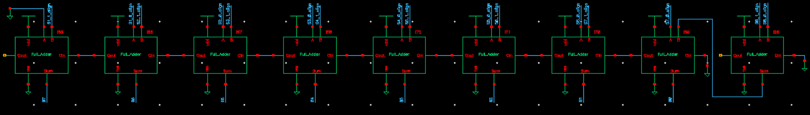

0.5 Bit correction Logic

The schematic adds the redundant bit of one stage to the carry out of the previous stage, with the last 1.5 bit stage output just being the summed together. This ensures that the output is digitally corrected and takes into account the redundancy.

## 8 Bit Pipeline ADC

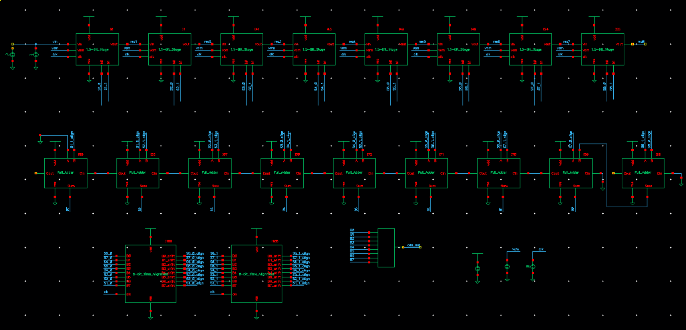

8 Bit Pipeline Circuit and test schematic

The final 8 Bit ADC schematic is created implementing all 8 1.5-Bit stages and the correcting logic, and the final schematic is shown above. The following section will detail the integration and optimization of the schematics in order to pass the metrics and get a higher ENOB.

## Design Reasoning + Process

After designing each component of the pipeline ADC and combining, many issues were found which resulted in very poor residuals and many missing codes. Due to offsets in the circuits such as from the track and hold and integrating all the components together, the residual voltages were not aligned with ideal values. In order to make the residual voltages as close as possible to the ideal values, the reference voltages generated by the DAC and the ADC are tuned. Adjusting the DAC voltages shifts the residual voltage up and down for each of the 3 sections, and the ADC voltage shifts the quantization point left and right. A test bench of the first stage was used to plot the residual voltage and adjust the ADC and DAC reference voltages.

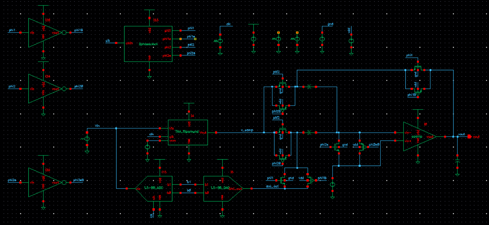

1.5 Bit Stage test schematic

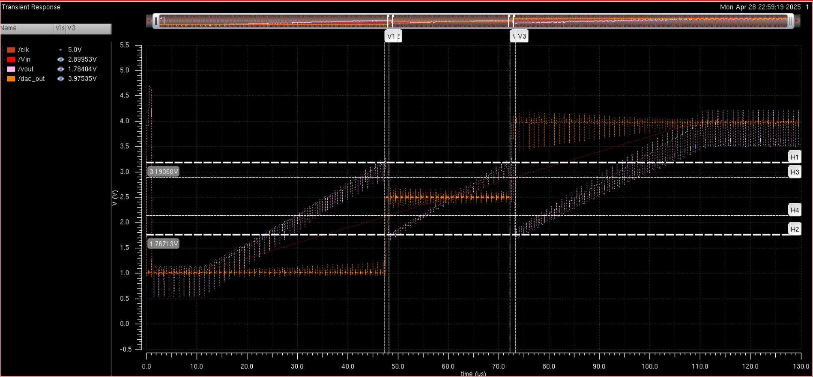

Residual switching voltage

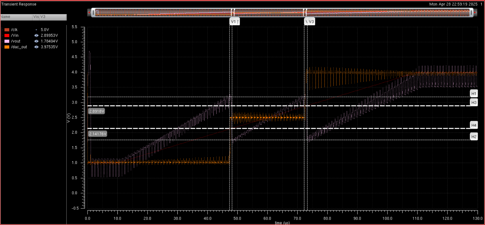

Residual Switching voltage on ramp

The voltage at which the residual switches on the end is ideally 3.25V on the high side and 1.75 on the low edge, with the switching point being as close as possible or the 2 switching points. The point at which it crosses the ramp should be as close to 2.125V and 2.875V, but due to it switching during the clock phase we try to get as close as possible. The resulting voltages are shown in the images above.

The voltages found for the ADC and DAC which generate the best residual voltages are listed in the table below.

| ADC calculated             | ADC simulated            | DAC calculated          | DAC simulated             |
|----------------------------|--------------------------|-------------------------|---------------------------|
| V<sub>ref1</sub> = 2.875 V | V<sub>ref1</sub> = 2.85V | V<sub>ref1</sub> = 4V   | V<sub>ref1</sub> = 3.975V |
| V<sub>ref2</sub> = 2.125 V | V<sub>ref2</sub> = 2.1V  | V<sub>ref2</sub> = 2.5V | V<sub>ref2</sub> = 2.5    |
|                            |                          | V<sub>ref3</sub> = 1V   | V<sub>ref3</sub> = 1.02   |

Table 1 – ADC & DAC V<sub>ref</sub> Values

### ADC Test Schematics and Simulation Results

The following screenshots are the residuals of each stage and the final output of the ADC from the ideal DAC (ADC transfer characteristic).

#### 8-Bit ADC Results

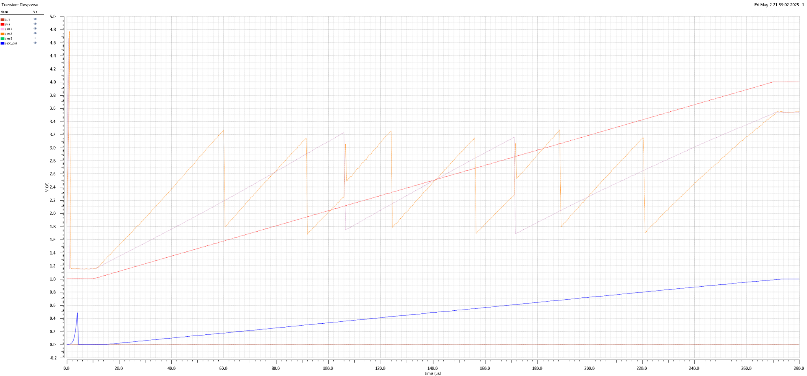

Input ramp plot with first two residuals and ideal DAC output

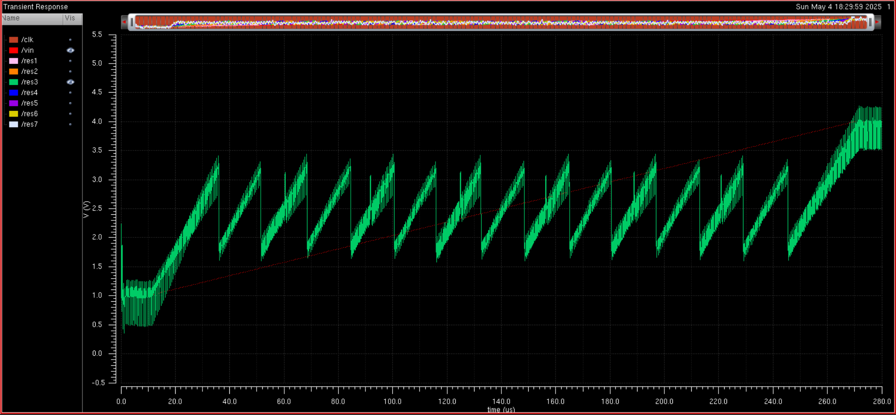

Third residual

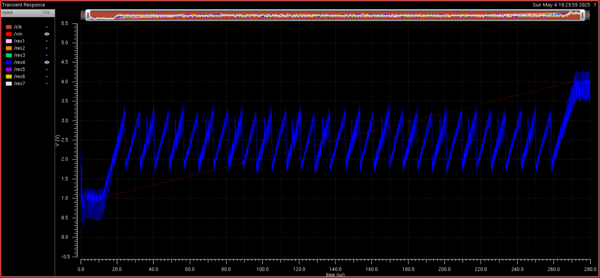

Fourth residual

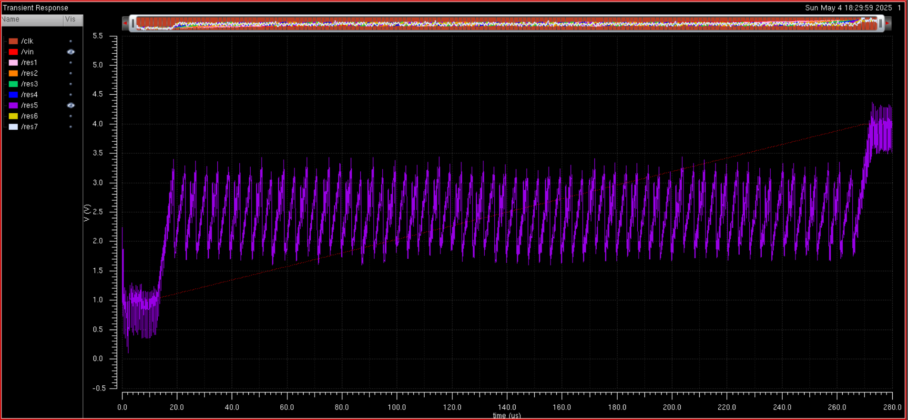

Fifth residual

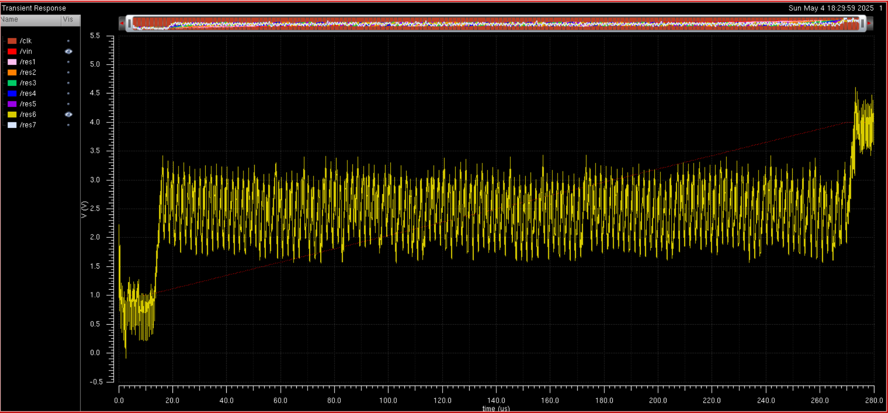

Sixth residual

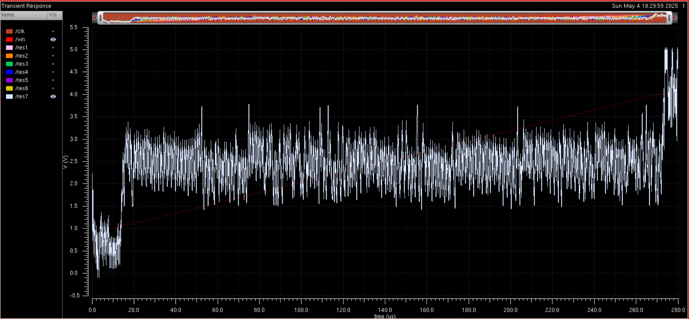

Final residual

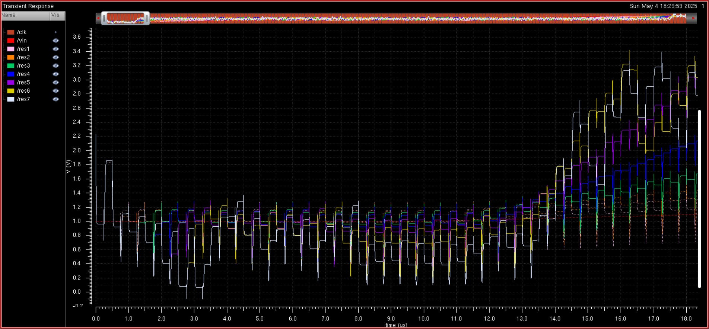

Initial residual offset

As seen, the residuals up until the last residual are very clear with minimal offsets, and the initial residual offset is very small with minimal variation up until the last residual, where the small errors are doubled every time by the MDAC.

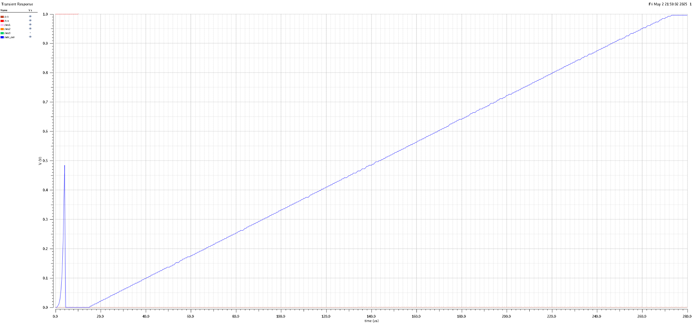

Ideal DAC output

Finally, the ADC transfer characteristic is generated from the ideal DAC. The transfer curve indicates that ADC is monotonic, with uniform code widths for the most part, with small regions having larger code widths. The digitally created transfer plot from the csv output is reported later, and is used to calculate INL and DNL.

### Frequency

Due to the ADC designed having an INL of larger than 1 at 2 MHz, and the required spec for the sampling frequency to be larger than 2MHz, the max frequency for our ADC is taken to be 2MHz.

### Power

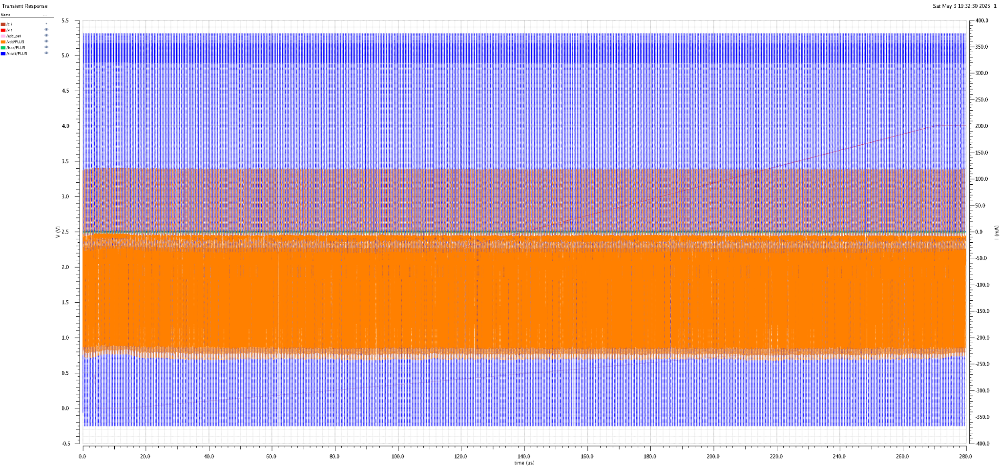

Power Measurement Simulation

| Expression                                | Value    | Expression                              | Value    | Expression                               | Value    |
|-------------------------------------------|----------|-----------------------------------------|----------|------------------------------------------|----------|
| ymax(i("/**clock**/PLUS" ?result "tran")) | 3.75E-01 | ymax(i("/**vdd**/PLUS" ?result "tran")) | 1.21E-01 | ymax(i("/**bias**/PLUS" ?result "tran")) | 3.96E-03 |

Table 2 – Power Simulation Results

Because the power remains constant at all values for all input voltages, as seen in the figure, we can assume the worst case for each the clock, V<sub>DD</sub>, and bias voltage sources are roughly the same as the worst case dynamic power. Thus we can calculate the power as:

P<sub>max</sub> = V<sub>DD</sub>I<sub>clock</sub> + V<sub>DD</sub>I<sub>vdd</sub> + V<sub>bias</sub>I<sub>bias</sub> = 5 \* .375 + 5 \* .121 + 2.5 \* .00396 = **2.49 W**

### Reported FOM

The figure of merit(FOM) was calculated using equation 1 which was given in the report. The FOM takes into account the power consumption, max frequency, and bits of the ADC to give it an overall grade. From the way the FOM is calculated, a low FOM is desired.

```math
(1)\ FOM = \frac{Power}{f_{s}{\cdot 2}^{B}}
```

```math
\ FOM = \frac{2.49}{2 \cdot 10^{6}{\cdot 2}^{8}} = 4.86 \cdot 10^{- 9}
```

### DNL/INL + SFDR, SNDR & ENOB

To fully characterize the pipeline ADC, the output data must be used to calculate the differential and integral nonlinearity(DNL/INL) and the spurious-free dynamic range(SFDR), signal-to-noise and distortion ratio(SNDR), and the effective number of bits(ENOB). The performance tests will be done using the MATLAB code written in homework 4 which can be found in the appendix. The first test was done to calculate the DNL/INL. To collect the data to be processed, an input ramp was applied for 260μs while using a clock frequency of 2MHz(500ns period). The output is expected to be a stair function with about 2 samples per code. The resulting data was then input to part 1 of the MATLAB code. In the code, the DNL is calculated by finding all the unique values in the data sequence and calculating how many times each value appears which is the code width. The array of how many times each code appears is then averaged to find the average code width. Equation 2 is then used to find the DNL and the cumulative sum of the DNL is used to find the INL.

```math
(2)\ DNL(k) = \frac{w_{k} - w_{avg}}{w_{avg}}
```

```math
(3)\ INL(k) = DNL(i)
```

The ADC output can be seen to be a stair function with 256 levels as expected. The DNL stays within the bounds of having an absolute value of less than one LSB with a maximum of 0.4825 LSB and a minimum of -0.5058 LSB. The INL does not stay within the desired range with a maximum LSB of 0.0856 LSB, but a minimum LSB of -1.5564. This means that many of the code widths in the beginning of the output were less than average and at the end many widths were greater than average. The results still show the ADC to work fairly well.

| Maximum DNL (LSB) | Minimum DNL (LSB) | Maximum INL (LSB) | Minimum INL (LSB) |
|-------------------|-------------------|-------------------|-------------------|
| 0.4825            | -0.5058           | 0.0856            | -1.5564           |

Table 3 – DNL/INL Ranges

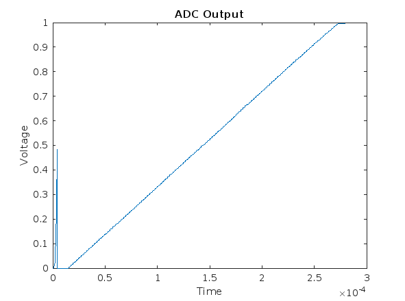

ADC Output (260μs Ramp, 2MHz Clock)

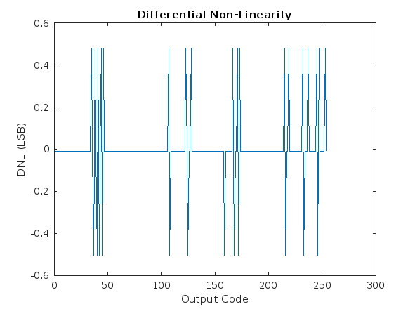

DNL Results

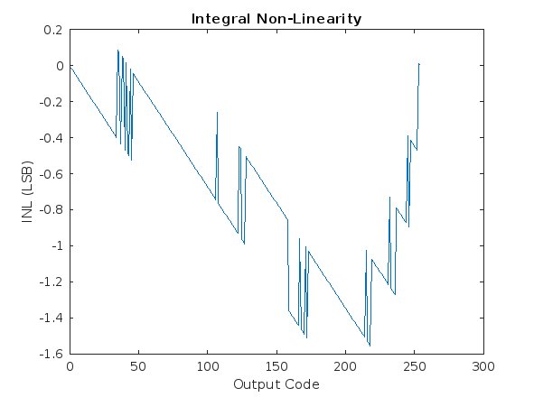

INL Results

Next, the SFDR and SNDR were calculated and the SNDR was used to calculate the ENOB using equation 5. For this test, a sinusoid with a frequency of 190kHz was input to the pipeline ADC and recovered using a DAC. The output data was then input to part 2 of the MATLAB code where the Fast Fourier Transform(FFT) of the sinusoid was calculated to see the distortion and noise induced on the signal. Ignoring the DC bin, the SNDR was calculated in decibels by finding the total power and removing the signal power to find the power of noise and distortion and using equation 3. The SFDR was calculated in decibels by finding the power of the largest spurious signal and using equation 4. The calculation of the ENOB in equation 6 resulted in 6.82 bits which does not meet the desired 8 bits, but is fairly close.

```math
(4)\ SNDR\  = \ 10log_{10}(\frac{P_{sig}}{P_{noise} + P_{distortion}})
```

```math
(5)\ SFDR\  = \ 10log_{10}(\frac{P_{sig}}{P_{spur}})
```

```math
(6)\ SNDR\  = \ 6.02 \times ENOB\  + \ 1.76dB
```

```math
(7)\ ENOB = \frac{SNDR - 1.76}{6.02}
```

| **SNDR (dB)** | **SFDR (dB)** | **ENOB (bits)** |
|---------------|---------------|-----------------|
| 42.8144       | 47.6373       | 6.82            |

Table 4 – SNDR, SFDR, and ENOB Results

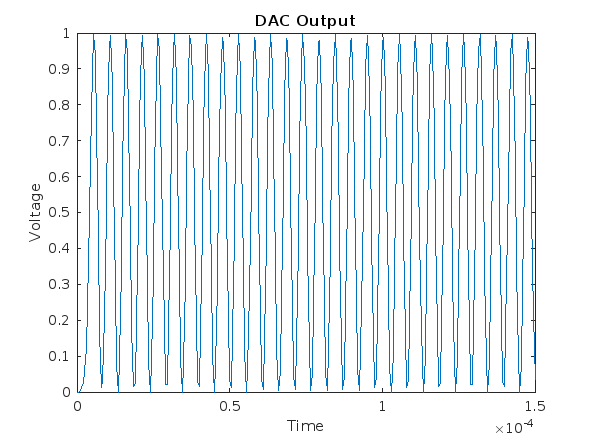

Recovered 190kHz Sinusoid

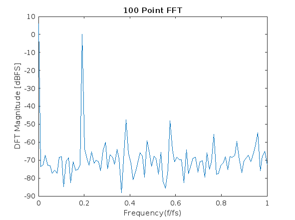

Frequency Response of Recovered Sinusoid

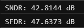

SNDR and SFDR Results

### Updated FOM

The FOM was then recalculated using the same equation as before, but now using the calculated ENOB to more accurately characterize the ADC.

```math
FOM = \frac{Power}{f_{s}{\cdot 2}^{ENOB}} = \frac{2.49}{2 \cdot 10^{6}{\cdot 2}^{6.82}} = 1.10 \cdot 10^{- 8}
```

### Conclusion

In this project, we successfully implemented an 8-bit, 1.5-bit per stage pipeline ADC that achieves an ENOB of 6.82 and a FOM of $1.10 \cdot 10^{- 8}$. Our design archives monotonic transfer characteristics with a DNL of \|.51\| LSB and INL from -1.56 LSB to +.085 LSB using a sampling frequency of 2 MHz. By leveraging redundancy in each stage and using digital error correction, we achieved high code integrity with 254 unique codes excluding endpoints, which means all 256 codes are achieved. Despite achieving all codes, there are still many unoptimized areas in the ADC due to time constraints, and as a result the FOM suffered.

Looking ahead, several improvements can be made to significantly improve performance, and reduce FOM, INL and DNL.

- SHA enhancement: implementing the bootstrap topology or further optimizing the current track and hold can lead to faster settling and more accurate tracking, which reduces error from tracking the input signal in each stage.

- Dual-phase sampling: By replacing the SHA in each stage with one SHA at the start, and having one stage sample while the preceding stage is outputting (alternating phase per stage), only one SHA is required which greatly reduces power consumption, area, and reduces startup latency from 8 to 4 clock cycles.

- Global Clock: Currently, each stage uses a non-overlapping clock generator, however by using one global clock generator, this reduces variation per stage, and greatly reduces power consumption and area.

- Time alignment simplification: Instead of using an 8-bit shift register for each stage to align time, only the minimum number of D flip-flop is required. This means the first stage uses 7 to delay 7 cycles, the second stage only needs 6 flip-flops, and the last stage can be taken directly from the output. This effectively halves the energy consumption used by the time alignment circuit.

- Sizing switch cap circuits: The switch capacitor transmission gate sizes were not optimal, and the SHA does not use transmission gates. By more accurately sizing these components, more precise residuals can be generated which would increase our sampling frequency and ENOB.

- Tuning ADC and DAC voltages: By tuning the ADC and DAC reference voltages, in conjunction with sizing the switch capacitor circuits, the residuals can be made more precise and increase ENOB.

## Appendix: MATLAB analysis code

### Part 1

```matlab
Array = readmatrix('pipeline_simulation_260uRamp_2MHz.csv');
t = Array(:, 1);
v = Array(:, 2);
t = t(:);
v = v(:);
plot(t, v);
title('ADC Output');
xlabel('Time');
ylabel('Voltage');
fsr = 2;
N = 2^8;
lsb = fsr/N;
[uniqueValues, ~, idx] = unique(v(12:end));
w = zeros(N-2, 1);
for i = 2:N-1
w(i-1) = sum(v(12:end) == uniqueValues(i));
end
wavg = mean(w);
DNL = (w - wavg)/wavg;
INL = cumsum(DNL);
max_INL = max(INL);
min_INL = min(INL);
max_DNL = max(DNL);
min_DNL = min(DNL);
n = 1:N-2;
plot(n, DNL);
title('Differential Non-Linearity');
xlabel('Output Code');
ylabel('DNL (LSB)');
plot(n, INL);
title('Integral Non-Linearity');
xlabel('Output Code');
ylabel('INL (LSB)');
fprintf('Max DNL: %.4f LSB\n', max_DNL);
fprintf('Min DNL: %.4f LSB\n', min_DNL);
fprintf('Max INL: %.4f LSB\n', max_INL);
fprintf('Min INL: %.4f LSB\n', min_INL);
```

### Part 2

```matlab
freq = 95000;
Fs = 1000000;
Ts = 1/Fs;
Array = readmatrix('pipeline_simulation_190kHz_sin_2MHz.csv');
t2 = Array(:, 1);
v2 = Array(:, 2);
plot(t2, v2);
title('DAC Output');
xlabel('Time');
ylabel('Voltage');
cycles = 19;
N = round(Fs*cycles/freq);
t3 = t2(20:N+20);
v3 = v2(20:N+20);
y = abs(fft(v3, N))/(max(v3)*(N/4));
ydb = mag2db(y);
ydb = ydb(1:end/2);
f = linspace(0, 1000000, N/2);
plot(f/Fs, ydb);
title('100 Point FFT');
xlabel('Frequency(f/fs)');
ylabel('DFT Magnitude [dBFS]');
Ptotal = sum(y(2:100).^2);
[Max, Maxindex] = findpeaks(ydb, 'MinPeakHeight', -1);
Psig = (y(Maxindex)^2);
Pnd = Ptotal - Psig;
SNDR = 10*log10(Psig/Pnd);
[peaks, index] = findpeaks(y, 'MinPeakHeight', -70);
descending = sort(peaks, 'descend');
Pspur = (descending(3)^2);
SFDR = 10*log10(Psig/Pspur);
fprintf('SNDR: %.4f dB\n', SNDR);
fprintf('SFDR: %.4f dB\n', SFDR);
```
